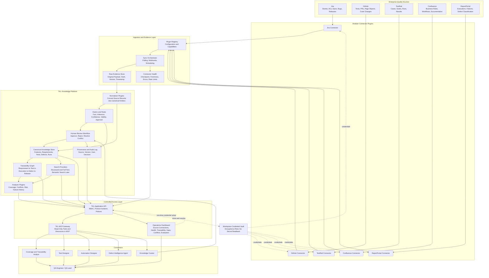
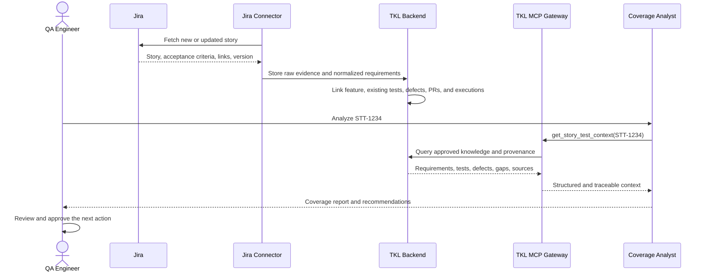
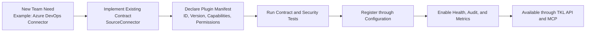

# Test Knowledge Library (TKL)
## Official Shareable Architecture Overview

> **Official architecture decision:** Build a modular TKL platform and expose its
> capabilities through a thin MCP gateway. Use Markdown only as an optional generated
> export and human-review format, not as the operational source of truth.

## What is TKL?

**TKL stands for Test Knowledge Library.**

It is a trusted and reusable quality context platform that collects, connects, and
organizes testing knowledge from multiple systems.

TKL does not replace Jira, TestRail, GitHub, Confluence, or ReportPortal. It creates a
shared context layer above them so AI agents and QA engineers can understand:

- What a feature is expected to do.
- Which business rules apply.
- Which requirements and acceptance criteria define it.
- Which manual and automated tests already cover it.
- Which defects and failures have affected it.
- Which risks, conflicts, and coverage gaps still exist.

The **TKL Backend** builds and maintains this knowledge. The **TKL MCP Gateway** makes it
available to AI agents through controlled, traceable tools and resources.

## The Idea in One Sentence

> Build quality context once, verify it, and reuse it across products, projects, and AI
> agents instead of making every agent rediscover the same information.

## What TKL Is and Is Not

| TKL is | TKL is not |
|---|---|
| A shared quality knowledge and traceability platform | A replacement for Jira, TestRail, GitHub, Confluence, or ReportPortal |
| A source of approved facts, relationships, evidence, and identified conflicts | A single AI agent |
| A reusable backend exposed through APIs and MCP | A monolithic MCP server containing every responsibility |
| A modular system extended through plugins | A collection of hard-coded product integrations |
| A human-governed decision-support system | An autonomous system that publishes unreviewed changes |

## Target Architecture



## How It Works

1. **Collect evidence:** connector plugins retrieve updated artifacts from the configured
   sources.
2. **Preserve the source:** the original record, version, timestamp, and hash are stored for
   auditability.
3. **Normalize knowledge:** source-specific records are converted into common entities such
   as requirements, test cases, automation tests, defects, and executions.
4. **Create traceability:** TKL links requirements to tests, executions, defects, pull
   requests, and releases.
5. **Separate truth from inference:** every claim records its source, confidence, validity,
   and human-approval status.
6. **Analyze quality:** analyzer plugins identify coverage gaps, conflicting rules, stale
   tests, risks, and failure patterns.
7. **Expose controlled context:** the MCP Gateway lets agents query the approved knowledge
   without giving them direct access to every source system.
8. **Keep humans in control:** proposed test cases, automation changes, flaky
   classifications, and business rules require review before publication.

### Knowledge Inventory / Quality Overview

`GET /v1/intelligence/knowledge-inventory` returns one bounded, aggregate-only snapshot that
distinguishes collected evidence (Bronze), canonical knowledge (Silver), mapped knowledge and
coverage quality, serving/pipeline status (Gold + backlogs), sync freshness, and
severity-ranked actionable gaps. It is computed exclusively from durable-store count/metadata
primitives (indexed `COUNT`/`GROUP BY` for Silver; a single index-field pass for Bronze) and
never scans full corpora, loads raw payloads, or triggers a source sync. It exists so that
durable inventory is never confused with Connector Health's runtime **Records (24h)**: a zero
runtime count does not imply data loss or require a resync. See
[runbooks/knowledge-inventory.md](../runbooks/knowledge-inventory.md) for exact metric
semantics, the coverage numerator/denominator and trust signal, and partial-state behavior.

### Canonical and Serving Storage

The local/default knowledge backend separates normalized canonical Silver tables from a
rebuildable Gold search projection. Every entity or searchable related-record mutation
writes a coalesced `serving_projection_outbox` row in the same SQLite transaction.
Bounded workers update the materialized entity document and acknowledge that row
atomically. Restart therefore causes at-least-once projection, never a permanently
missing search record.

SQLite FTS5 with trigram tokenization provides local full-text substring search when the
runtime includes FTS5. Tenant/product isolation and source filtering are relational
constraints; legacy ID/title matches remain first in canonical insertion order, followed
deterministically by supplemental canonical-text matches before pagination. Empty
queries use the materialized projection without `MATCH`. Runtimes without FTS5 use the
same versioned materialized document and deterministic fallback.

The production scale-out direction remains PostgreSQL. pgvector may later support
evaluated semantic/hybrid retrieval, but this phase introduces neither a vector database
nor placeholder/fake embeddings.

### Sync Orchestrator (implemented)

The "Sync Orchestrator" node above is implemented by `packages/sync-coordinator`
(`@tkl/sync-coordinator`, `OPS-101`). Its boundaries are deliberate:

- It composes connectors through `@tkl/ingestion` from validated product configuration
  and commits through the `@tkl/raw-evidence-store` contract. It holds no source
  knowledge, so adding or disabling a connector stays a configuration change.
- Evidence and the next checkpoint are committed in **one** store transaction, so a
  cursor can never move past unpersisted evidence; a failed run commits what it fetched
  but never advances the cursor, so a restart can duplicate reads but never skip
  evidence. Duplicates collapse on deterministic idempotency keys.
- **Scheduling is external.** One `runOnce()` per cron/job-runner trigger; no embedded
  daemon, timers, or missed-tick policy. The cadence itself remains a pending external
  decision.
- Replays (`replay-from-checkpoint`, `replay-full`) require explicit confirmation,
  support a dry-run plan, and never clear or silently rewind a stored checkpoint.
- Retention is a **reporting** seam, not a pruner: raw evidence is immutable provenance
  and the durable store exposes no deletion API.
- Overlapping runs are prevented per tenant/product/connector **within a process**;
  cross-process exclusion still requires one ingestion process per scope, or an injected
  external lease.

See `docs/runbooks/scheduled-sync.md` and `packages/sync-coordinator/README.md`.

### Workspace Source Connections

TKL supports a bring-your-own-connection workflow for each tenant/product workspace:

1. An authorized connection owner enters a source credential and an explicit source
   allowlist in the dashboard.
2. The dashboard sends the credential once to the Application API over HTTPS. It does
   not store it in browser storage and clears the credential field after the request.
3. The API validates the target host against the deployment allowlist, tests the
   credential with a bounded source-specific request, and stores it in the encrypted
   credential vault.
4. The API returns only sanitized connection metadata: status, owner, timestamps,
   allowlisted scope, and safe error information. Credential values are never returned.
5. A manual or scheduled sync resolves the credential only inside the connector process,
   commits encrypted raw evidence, normalizes it into the durable canonical knowledge
   store, and publishes health/freshness metadata.

GitHub, Jira, TestRail, Confluence, and ReportPortal support validation and ingestion
through workspace Source Connections. Confluence ingests explicitly labeled requirement
pages; ReportPortal ingests launches and test items while preserving only explicit defect
classifications and external issue identities. MCP remains stateless and receives no
source credential; it queries the product-scoped Application API only.

## Example: Processing a New Jira Story



### Expected Output

```text
Story: STT-1234
Feature: Create Deal

Requirements found:       8
Existing manual tests:    5
Existing automated tests: 3
Relevant defects:         2
Potential coverage gaps:  3
Knowledge conflicts:      1

Every result includes its Jira, GitHub, or approved knowledge source.
```

## Modular Extension Model

TKL uses stable contracts and a plugin registry. A new capability is added as a module,
not by changing the core orchestration.



### Extension contracts

| Contract | Extension purpose |
|---|---|
| `SourceConnector` | Add Jira, GitHub, TestRail, Confluence, ReportPortal, or another source |
| `Normalizer` | Convert source records into canonical entities and claims |
| `KnowledgeStore` | Change persistence without changing connectors or agents |
| `SearchProvider` | Add full-text, semantic, or hybrid search |
| `Analyzer` | Add coverage, risk, conflict, or failure analysis |
| `McpCapabilityProvider` | Add controlled MCP tools or resources |
| `AgentConsumer` | Add a specialized agent without coupling it to source APIs |

Modules can initially live in one modular monorepo and run as one process. This keeps the
MVP simple while preserving boundaries that allow independent ownership, testing,
versioning, and future deployment.

## MVP

The first version proves one useful flow instead of attempting the entire vision.

| Item | MVP decision |
|---|---|
| Pilot product | FL Titling |
| Data sources | Jira and GitHub |
| Primary capability | Story context, traceability, and coverage-gap analysis |
| First agent | Read-only Coverage and Traceability Analyst |
| Storage | Canonical relational store plus trace links |
| Search | Structured and full-text |
| Dashboard | Connector health, traceability, gaps, conflicts, evaluation |
| Writes | Not allowed |
| Human approval | Required for every proposed knowledge or test change |

## Active Phase 2 Extension

TestRail is now the active source extension. It contributes suites, cases, runs, and
results to the canonical model so the platform can compare requirement coverage, manual
coverage, automation coverage, and recent execution evidence. The live connector remains
disabled until approved connection metadata and a read-only credential reference are
configured outside the repository.

## Team of Five

| Owner | Responsibility |
|---|---|
| Architecture and Contracts | Canonical model, plugin contracts, schemas, integration |
| Ingestion | Jira/GitHub/TestRail plugins, incremental sync, checkpoints, raw evidence |
| Knowledge and Traceability | Claims, provenance, trace links, coverage analysis |
| MCP and Security | API, MCP gateway, RBAC, policies, audit |
| UX and Evaluation | Dashboard, golden dataset, usability and effectiveness metrics |

## Success Definition

The MVP succeeds if, for a representative Jira story, it can:

- Retrieve the correct requirements and acceptance criteria.
- Find the relevant existing automated tests and defects.
- Identify meaningful coverage gaps.
- Explain every relationship with verifiable provenance.
- Prevent knowledge or data from leaking between products.
- Reduce the time required for human impact and coverage analysis.
